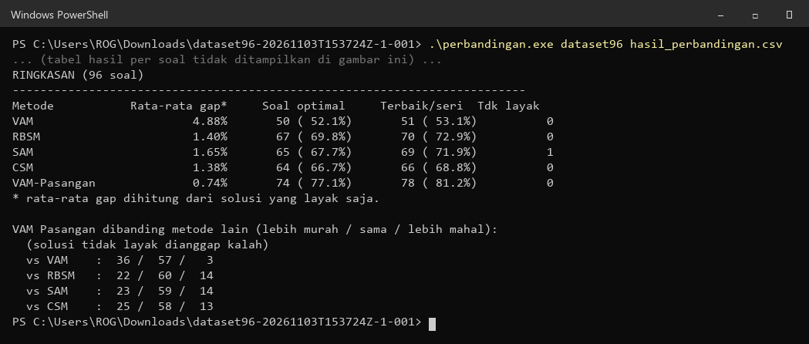
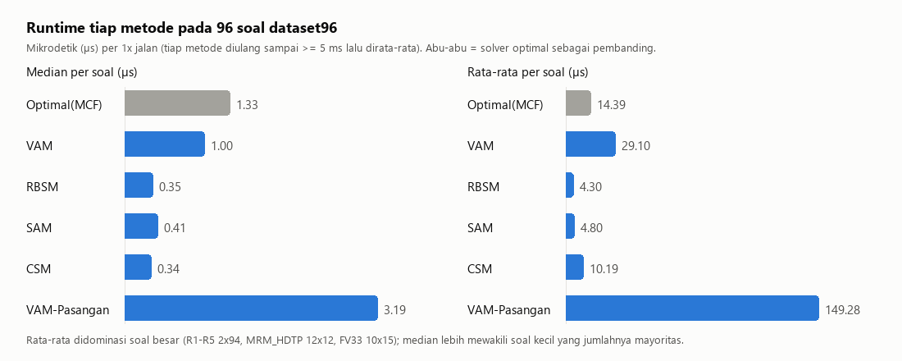
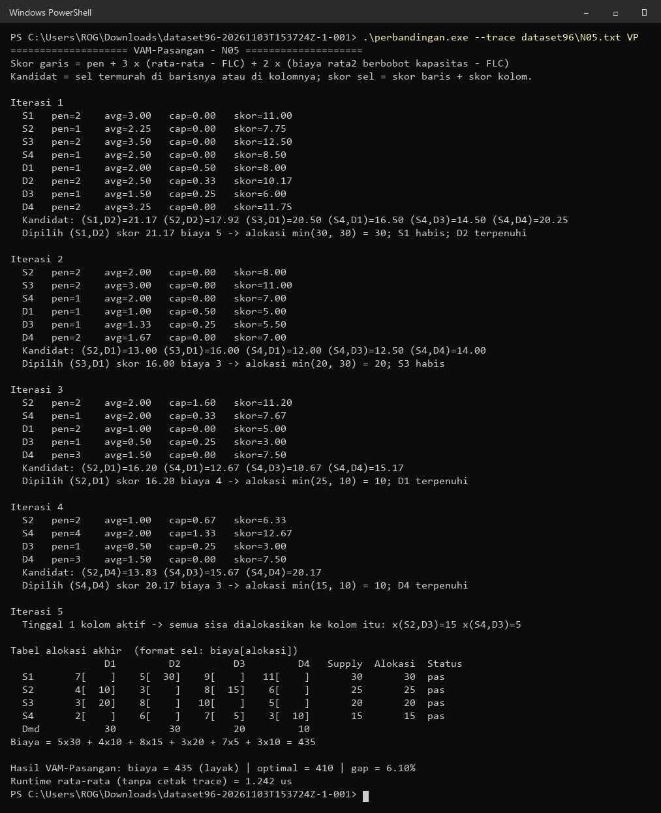

# VAM Pasangan: Perbandingan Metode Solusi Awal Masalah Transportasi

Proyek Riset Operasi Kelompok 2. Repo ini berisi program C yang membandingkan **5 metode solusi awal (IBFS)** untuk masalah transportasi pada **96 soal** di `dataset96`. Metode yang kami usulkan adalah **VAM Pasangan**. Hasil tiap metode dibandingkan dengan biaya **optimal**, yang dihitung dengan *min-cost flow*.

## Metode yang dibandingkan

| No | Metode | Keterangan singkat |
|---|---|---|
| 1 | **VAM** | Vogel's Approximation Method. Penalti = biaya termurah ke-2 − termurah; sel dipilih dari baris/kolom dengan penalti terbesar. |
| 2 | **RBSM** | Alokasi awal ke sel termurah tiap kolom, lalu kelebihan supply dipindahkan dari baris "donatur" ke baris "penerima" dengan selisih biaya terkecil. |
| 3 | **SAM** | Alokasi awal ke sel termurah tiap kolom, lalu konflik diselesaikan lewat FLC/SLC dan ACS (rata-rata biaya × supply). Dibatasi 20 iterasi. |
| 4 | **CSM** | Cost Supply Method (Bunyamin dkk., ETASR 2026). Mirip RBSM, tetapi memakai CS = TC × supply untuk menentukan baris yang dipuaskan. |
| 5 | **VAM Pasangan** | Metode usulan, dijelaskan di bawah. |

**Cara kerja VAM Pasangan:**
- Tiap baris/kolom diberi skor: `penalti + 3 × (rata-rata − FLC) + 2 × (biaya rata-rata berbobot kapasitas − FLC)`.
- Kandidat adalah sel yang termurah di barisnya **atau** di kolomnya.
- Skor sel = skor baris + skor kolom. Sel dengan skor tertinggi dialokasikan lebih dulu.
- Jika skor seri, dipilih biaya yang lebih murah, lalu alokasi yang lebih besar.

Soal yang tidak seimbang diseimbangkan dulu dengan baris atau kolom **dummy** berbiaya 0.

## Hasil



| Metode | Rata-rata gap* | Soal optimal | Terbaik/seri | Tidak layak |
|---|---:|---:|---:|---:|
| VAM | 4,88% | 50 (52,1%) | 51 (53,1%) | 0 |
| RBSM | 1,40% | 67 (69,8%) | 70 (72,9%) | 0 |
| SAM | 1,65% | 65 (67,7%) | 69 (71,9%) | 1 |
| CSM | 1,38% | 64 (66,7%) | 66 (68,8%) | 0 |
| **VAM Pasangan** | **0,74%** | **74 (77,1%)** | **78 (81,2%)** | 0 |

\* Gap = (biaya metode − biaya optimal) / biaya optimal. Rata-rata gap hanya dihitung dari solusi yang layak. SAM menghasilkan solusi tidak layak pada soal FV33.

VAM Pasangan dibanding metode lain (jumlah soal lebih murah / sama / lebih mahal):

| vs | Lebih murah | Sama | Lebih mahal |
|---|---:|---:|---:|
| VAM | 36 | 57 | 3 |
| RBSM | 22 | 60 | 14 |
| SAM | 23 | 59 | 14 |
| CSM | 25 | 58 | 13 |

Hasil lengkap per soal ada di [hasil_perbandingan.txt](hasil_perbandingan.txt) dan [hasil_perbandingan.csv](hasil_perbandingan.csv).

## Runtime

Satu kali jalan sebuah metode bisa memakan waktu di bawah 1 µs. Karena itu, tiap metode diulang sampai totalnya ≥ 5 ms, lalu waktunya dirata-rata. Waktu membaca file tidak ikut dihitung.



| Metode | Median (µs) | Rata-rata (µs) | Maks (µs) | Tercepat di |
|---|---:|---:|---:|---:|
| Optimal (MCF), pembanding | 1,33 | 14,39 | 454,6 | – |
| VAM | 1,00 | 29,10 | 2217,2 | 3 soal |
| RBSM | 0,35 | 4,30 | 145,4 | 29 soal |
| SAM | 0,41 | 4,80 | 170,9 | 13 soal |
| CSM | 0,34 | 10,19 | 722,6 | 51 soal |
| VAM Pasangan | 3,19 | 149,28 | 2985,3 | 0 soal |

VAM Pasangan menghasilkan gap terkecil, tetapi paling lambat karena menghitung skor setiap baris dan kolom di setiap iterasi. Selisihnya tetap dalam orde mikrodetik. Rata-rata waktu didominasi soal besar (R1–R5 2x94, MRM_HDTP 12x12, FV33 10x15), jadi median lebih mewakili soal kecil yang jumlahnya mayoritas. Angka runtime bisa sedikit berbeda setiap kali program dijalankan.

Detail per soal: [images/02_runtime_ringkasan.png](images/02_runtime_ringkasan.png) dan [images/04_runtime_per_soal.png](images/04_runtime_per_soal.png).

## Contoh langkah demi langkah

Program bisa mencetak setiap iterasi tiap metode untuk satu soal. Capture-nya ada di [images/step_by_step/](images/step_by_step/) untuk dua soal:

- **CIDI01** (3x3): contoh sederhana. VAM menghasilkan 520, metode lain mencapai optimal 380.
- **N05** (4x4): iterasinya lebih banyak, dan semua metode menghasilkan biaya di atas optimal 410.

| | CIDI01 | N05 |
|---|---|---|
| Soal | [lihat](images/step_by_step/CIDI01_0_soal.png) | [lihat](images/step_by_step/N05_0_soal.png) |
| Optimal (MCF) | [lihat](images/step_by_step/CIDI01_1_optimal.png) | [lihat](images/step_by_step/N05_1_optimal.png) |
| VAM | [lihat](images/step_by_step/CIDI01_2_VAM.png) | [lihat](images/step_by_step/N05_2_VAM.png) |
| RBSM | [lihat](images/step_by_step/CIDI01_3_RBSM.png) | [lihat](images/step_by_step/N05_3_RBSM.png) |
| SAM | [lihat](images/step_by_step/CIDI01_4_SAM.png) | [lihat](images/step_by_step/N05_4_SAM.png) |
| CSM | [lihat](images/step_by_step/CIDI01_5_CSM.png) | [lihat](images/step_by_step/N05_5_CSM.png) |
| VAM Pasangan | [lihat](images/step_by_step/CIDI01_6_VAM-Pasangan.png) | [lihat](images/step_by_step/N05_6_VAM-Pasangan.png) |

Contoh: VAM Pasangan pada soal N05.



## Cara menjalankan

Butuh compiler C (GCC/MinGW). Untuk membuat gambar, butuh juga Python dengan Pillow.

```bash
# kompilasi
gcc -O2 -o perbandingan perbandingan.c -lm

# bandingkan semua soal; hasil ke layar + CSV
./perbandingan dataset96 hasil_perbandingan.csv > hasil_perbandingan.txt

# langkah demi langkah satu soal
./perbandingan --trace dataset96/N05.txt ALL
./perbandingan --trace dataset96/N05.txt VP
```

Pilihan metode untuk `--trace`: `SOAL`, `OPT`, `VAM`, `RBSM`, `SAM`, `CSM`, `VP` (VAM Pasangan), atau `ALL`.

Membuat ulang semua gambar di folder `images/`:

```bash
python buat_gambar.py
```

Jalankan perintah ini setelah `hasil_perbandingan.txt` diperbarui. Script membaca file txt tersebut dan menjalankan `perbandingan.exe --trace`.

## Format file soal

Setiap file `.txt` di `dataset96/` berformat:

```
m n
c11 c12 ... c1n
...
cm1 cm2 ... cmn
s1 s2 ... sm
d1 d2 ... dn
```

`m` = jumlah sumber (supply), `n` = jumlah tujuan (demand), `c` = matriks biaya, `s` = supply, `d` = demand.

## Struktur repo

```
├── perbandingan.c           # program utama: 5 metode + optimal + runtime + mode trace
├── perbandingan.exe         # hasil kompilasi (Windows)
├── buat_gambar.py           # pembuat gambar capture & grafik
├── hasil_perbandingan.txt   # output lengkap program
├── hasil_perbandingan.csv   # hasil per soal: biaya, gap, runtime
├── dataset96/               # 96 soal transportasi
└── images/                  # ringkasan, runtime, dan capture step by step
```
